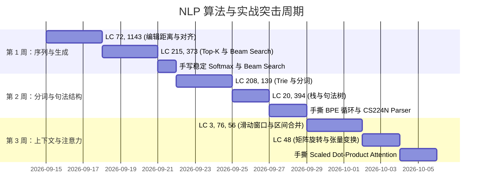

# 🧠 NLP 算法基础与 CS224N 定向刷题指南

> **写在前面**：  
> 很多同学数学基础扎实、PyTorch 语法熟悉，但面对 CS224N 作业和前沿 NLP 模型时，依然觉得“代码写不动”。  
> 其根本症结在于**缺乏将算法思维映射到张量与序列处理上的手感**。传统的 LeetCode 刷题往往包含大量与深度学习无关的冷门算法（如红黑树、复杂网络流等），盲目刷题性价比极低。  
> 本指南专为打通**经典算法思维**到**深度学习与 NLP 工程实现**的“临门一脚”而设计。

---

## 目录
- [一、 核心思维映射：从 LeetCode 到 Deep Learning](#一-核心思维映射从-leetcode-到-deep-learning)
- [二、 深度学习与 NLP 定向题单（精选 20 题）](#二-深度学习与-nlp-定向题单精选-20-题)
  - [模块 1：序列动态规划（对齐、编辑距离与解码）](#模块-1序列动态规划对齐编辑距离与解码)
  - [模块 2：堆与优先队列（Top-K 采样与 Beam Search）](#模块-2堆与优先队列top-k-采样与-beam-search)
  - [模块 3：字典树 Trie（Tokenizer 与分词匹配）](#模块-3字典树-trie-tokenizer-与分词匹配)
  - [模块 4：栈与状态机（依存句法分析）](#模块-4栈与状态机依存句法分析)
  - [模块 5：双指针与滑动窗口（Context Window 与实体切片）](#模块-5双指针与滑动窗口context-window-与实体切片)
  - [模块 6：矩阵变换与掩码思维（Attention Mask）](#模块-6矩阵变换与掩码思维attention-mask)
- [三、 临门一脚：手撕 4 大 NLP 核心微算子（附代码模板）](#三-临门一脚手撕-4-大-nlp-核心微算子附代码模板)
  - [1. 数值稳定的 Softmax](#1-数值稳定的-softmax)
  - [2. 带因果掩码的缩放点积注意力 (Scaled Dot-Product Attention)](#2-带因果掩码的缩放点积注意力-scaled-dot-product-attention)
  - [3. 极简 Beam Search 解码逻辑](#3-极简-beam-search-解码逻辑)
  - [4. BPE (Byte-Pair Encoding) 词表构建核心循环](#4-bpe-byte-pair-encoding-词表构建核心循环)
- [四、 2~3 周突击日程表](#四-23-周突击日程表)

---

## 一、 核心思维映射：从 LeetCode 到 Deep Learning

| 经典算法结构 | 核心算法直觉 | 对应 NLP / 深度学习机制 | CS224N / LLM 关键场景 |
| :--- | :--- | :--- | :--- |
| **二维 DP** | 状态表格转移、序列匹配与最优对齐 | 序列对齐矩阵、Trellis 状态网格 | 编辑距离 (Edit Distance)、Viterbi 算法、ROUGE-L 评价 |
| **堆 (Heap)** | 动态候选空间维护、Top-K 剪枝 | 自回归解码中的概率优选 | Top-K 采样、Beam Search（束搜索） |
| **字典树 (Trie)** | 前缀匹配、公共路径复用、动态切分 | 词表查找、子词（Subword）切分 | Tokenizer (BPE/WordPiece)、前缀引导受限生成 |
| **栈 (Stack)** | 嵌套解析、逆序回溯、操作转移 | 语法树（Parse Tree）还原、转移式句法解析 | CS224N Assignment 3 (Transition-based Parser) |
| **滑动窗口** | 动态局部感知区间、双指针边界滑动 | 上下文窗口截断、局部注意力 | Word2Vec Skip-Gram 负采样、Sliding Window Attention |
| **矩阵变换** | 二维坐标翻转、区域过滤与掩码 | 矩阵转置、张量维度广播、因果掩码 | Multi-Head Attention 中的 QK 转置与 Causal Mask |

---

## 二、 深度学习与 NLP 定向题单（精选 20 题）

### 模块 1：序列动态规划（对齐、编辑距离与解码）
> **NLP 背景**：文本相似度比较、模型生成质量评测（BLEU/ROUGE）、传统命名实体识别与分词的最优序列解码（HMM/CRF 的 Viterbi 算法，本质就是网格 DP）。

| 题号 | 题目名称 | 难度 | 核心考察点 | 深度学习迁移要点 |
| :---: | :--- | :---: | :--- | :--- |
| **72** | **编辑距离 (Edit Distance)** | 困难 | 双序列二维 DP 状态转移 | **NLP 殿堂级题目**。手写字符插入/删除/替换代价矩阵，透彻理解对齐网格。 |
| **1143** | **最长公共子序列 (LCS)** | 中等 | 二维 DP 边界与相等匹配 | 机器翻译与文本摘要评测指标 ROUGE-L 的底层算法。 |
| **139** | **单词拆分** | 中等 | 一维 DP + 词典子串切分 | 类似 Tokenizer 根据固定词表对连续文本切分的最优判定。 |
| **53** | **最大子数组和** | 简单 | 前缀状态累积与贪心重置 | 理解序列信息传递中的“重置”与“遗忘”机制（类比 GRU/LSTM 门控思想）。 |

---

### 模块 2：堆与优先队列（Top-K 采样与 Beam Search）
> **NLP 背景**：语言模型（如 GPT、LLaMA、T5）在解码生成文本时，每一步都需要从成千上万个词表中过滤出最高概率的词（Top-K/Top-P），或维护最优解码路径（Beam Search）。

| 题号 | 题目名称 | 难度 | 核心考察点 | 深度学习迁移要点 |
| :---: | :--- | :---: | :--- | :--- |
| **215** | **数组中的第K个最大元素** | 中等 | 堆维护 / 快速选择算法 | **必刷**。自回归生成每步 Top-K 过滤的基础逻辑。 |
| **347** | **前 K 个高频元素** | 中等 | 哈希计数 + 优先队列 | 词频统计（Term Frequency）、高频词表（Vocab）构建的标准范式。 |
| **373** | **查找和最小的 K 对数字** | 中等 | 多路归并 + 小顶堆优选 | **Beam Search 的神级平替题**：在多个分支扩展中动态保留全局最优的 K 个状态。 |
| **295** | **数据流的中位数** | 困难 | 大顶堆 + 小顶堆动态对顶 | 动态分位数维护，理解 Top-P（核采样）动态概率截断的思想。 |

---

### 模块 3：字典树 Trie（Tokenizer 与分词匹配）
> **NLP 背景**：现代 NLP 最关键的数据预处理就是 Tokenizer（如 WordPiece、Byte-Pair Encoding、SentencePiece）。底层的词表存储、前缀匹配及最大匹配分词均依赖 Trie。

| 题号 | 题目名称 | 难度 | 核心考察点 | 深度学习迁移要点 |
| :---: | :--- | :---: | :--- | :--- |
| **208** | **实现 Trie (前缀树)** | 中等 | 多叉树节点构建、插入与检索 | **必刷**。所有 Tokenizer 的核心数据结构，掌握 `children` 字典与 `is_end` 标记。 |
| **211** | **添加与搜索单词** | 中等 | Trie + DFS 递归通配符匹配 | 理解词表带掩码（`[MASK]` Token）或未知词通配时的模糊匹配。 |
| **140** | **单词拆分 II** | 困难 | Trie / 记忆化回溯全路径 | 探索给定词表下所有可能的分词方案（类似分词器的候选切分探索）。 |

---

### 模块 4：栈与状态机（依存句法分析）
> **NLP 背景**：CS224N 的经典核心作业之一是 **Transition-based Dependency Parser**（基于转移的依存句法分析器），其核心状态由 Stack、Buffer 和 Dependency Arcs 构成。

| 题号 | 题目名称 | 难度 | 核心考察点 | 深度学习迁移要点 |
| :---: | :--- | :---: | :--- | :--- |
| **20** | **有效的括号** | 简单 | 基础栈出入匹配 | 语法树（Parse Tree）合法性验证的最底层逻辑。 |
| **739** | **每日温度** | 中等 | 单调栈线性扫描 | 寻找序列中距离最近的符合特定上下文条件的词（左/右依赖弧分析）。 |
| **394** | **字符串解码** | 中等 | 辅助栈 + 嵌套递归解析 | 理解嵌套表达式与上下文归属，对应句法树解析（Constituency Parsing）。 |

---

### 模块 5：双指针与滑动窗口（Context Window 与实体切片）
> **NLP 背景**：Word2Vec 的 Skip-Gram/CBOW 上下文采样、Transformer 的滑动窗口局部注意力（Sliding Window Attention）、命名实体识别（NER）的 Span 抽取。

| 题号 | 题目名称 | 难度 | 核心考察点 | 深度学习迁移要点 |
| :---: | :--- | :---: | :--- | :--- |
| **3** | **无重复字符的最长子串** | 中等 | 哈希映射 + 滑动窗口双指针 | **必刷**。动态窗口边界收缩与扩张的经典模式。 |
| **76** | **最小覆盖子串** | 困难 | 字符频次统计 + 动态窗口精准缩放 | 模拟在长文本上下文中检索包含全部关键实体（Tokens）的最紧凑局部片段。 |
| **56** | **合并区间** | 中等 | 区间排序 + 贪心合并 | NER 实体 Span 冲突解决、文本分块（Chunking）排重的必备操作。 |

---

### 模块 6：矩阵变换与掩码思维（Attention Mask）
> **NLP 背景**：Transformer 注意力计算中的下三角掩码（Causal/Autoregressive Mask）、填充掩码（Padding Mask）、维度对齐与置换（Permute/Transpose）。

| 题号 | 题目名称 | 难度 | 核心考察点 | 深度学习迁移要点 |
| :---: | :--- | :---: | :--- | :--- |
| **48** | **旋转图像** | 中等 | 原地矩阵转置与水平翻转 | 培养二维/多维张量坐标变换与 `transpose(-1, -2)` 的几何直觉。 |
| **54** | **螺旋矩阵** | 中等 | 边界指针收缩与网格遍历 | 锻炼张量切片（Slicing）与边界条件（Index Padding）的精确度。 |

---

## 三、 临门一脚：手撕 4 大 NLP 核心微算子（附代码模板）

做完对应的算法题后，用纯 Python/NumPy/PyTorch 默写以下 4 个算子，体验算法直觉落地到深度学习代码中的瞬间。

### 1. 数值稳定的 Softmax
> **对应算法**：数组最大值检索 + 归一化  
> **工程考点**：防止大数值 $\exp(x)$ 上溢（Overflow）导致 `NaN`。

```python
import numpy as np

def stable_softmax(x: np.ndarray, axis: int = -1) -> np.ndarray:
    """
    数学原理: softmax(x_i) = exp(x_i - max(x)) / sum(exp(x_j - max(x)))
    """
    # 沿着指定维度提取最大值，保持维度以便广播
    x_max = np.max(x, axis=axis, keepdims=True)
    exp_x = np.exp(x - x_max)
    sum_exp_x = np.sum(exp_x, axis=axis, keepdims=True)
    return exp_x / sum_exp_x

# 测试
logits = np.array([[1000.0, 1001.0, 1002.0], [1.0, 2.0, 3.0]])
print("Softmax 输出:\n", stable_softmax(logits))
```

---

### 2. 带因果掩码的缩放点积注意力 (Scaled Dot-Product Attention)
> **对应算法**：矩阵乘法 + 二维上三角掩码  
> **工程考点**：因果遮蔽（屏蔽未来 Token），防止在自回归任务中信息泄露。

```python
import torch
import torch.nn.functional as F

def scaled_dot_product_attention(
    Q: torch.Tensor, 
    K: torch.Tensor, 
    V: torch.Tensor, 
    is_causal: bool = True
) -> torch.Tensor:
    """
    Q, K, V shape: [batch_size, num_heads, seq_len, head_dim]
    """
    d_k = Q.size(-1)
    seq_len = Q.size(-2)
    
    # 1. 计算点积相似度 scores: [batch, heads, seq_len, seq_len]
    scores = torch.matmul(Q, K.transpose(-1, -2)) / (d_k ** 0.5)
    
    # 2. 因果掩码 (Causal Mask): 上三角填充 -inf
    if is_causal:
        mask = torch.triu(torch.ones(seq_len, seq_len, device=Q.device), diagonal=1).bool()
        scores = scores.masked_fill(mask, float('-inf'))
        
    # 3. 计算注意力权重并加权
    attn_weights = F.softmax(scores, dim=-1)
    output = torch.matmul(attn_weights, V)  # [batch, heads, seq_len, head_dim]
    return output

# 测试
q = k = v = torch.randn(2, 4, 8, 32)
out = scaled_dot_product_attention(q, k, v, is_causal=True)
print("Attention 输出张量 Shape:", out.shape)
```

---

### 3. 极简 Beam Search 解码逻辑
> **对应算法**：LeetCode 373 / 优先队列维护 Top-K 路径  
> **工程考点**：语言模型生成时，每一步维护 $B$ 条最高累积概率的路径。

```python
import heapq
import numpy as np

def beam_search_decoder(step_probs_fn, start_token=1, eos_token=2, beam_width=3, max_len=10):
    """
    极简 Beam Search 实现
    step_probs_fn(seq): 模拟模型前向传播，返回下一个词的概率向量
    """
    # 堆中存储: (-log_prob, sequence)
    # 使用负数以构建大顶堆特性（heapq 默认为小顶堆）
    sequences = [[-0.0, [start_token]]]
    
    for _ in range(max_len):
        candidates = []
        all_completed = True
        
        for neg_log_p, seq in sequences:
            if seq[-1] == eos_token:
                candidates.append((neg_log_p, seq))
                continue
            
            all_completed = False
            probs = step_probs_fn(seq)  # 获取词表概率分布 (V,)
            top_k_indices = np.argsort(probs)[-beam_width:]
            
            for idx in top_k_indices:
                score = neg_log_p - np.log(probs[idx] + 1e-12)
                candidates.append((score, seq + [int(idx)]))
                
        # 截断保留最优的前 beam_width 个序列
        candidates.sort(key=lambda x: x[0])
        sequences = candidates[:beam_width]
        
        if all_completed:
            break
            
    best_score, best_seq = sequences[0]
    return best_seq

# 模拟概率函数测试
vocab_size = 10
mock_prob_fn = lambda seq: np.ones(vocab_size) / vocab_size
res = beam_search_decoder(mock_prob_fn, max_len=5)
print("Beam Search 解码出的 Token 序列:", res)
```

---

### 4. BPE (Byte-Pair Encoding) 词表构建核心循环
> **对应算法**：哈希统计 + 贪心合并相邻元素  
> **工程考点**：分词器底层的子词学习逻辑。

```python
import collections

def get_stats(vocab):
    pairs = collections.defaultdict(int)
    for word, freq in vocab.items():
        symbols = word.split()
        for i in range(len(symbols) - 1):
            pairs[symbols[i], symbols[i+1]] += freq
    return pairs

def merge_vocab(pair, v_in):
    v_out = {}
    bigram = ' '.join(pair)
    replacement = ''.join(pair)
    for word in v_in:
        w_out = word.replace(bigram, replacement)
        v_out[w_out] = v_in[word]
    return v_out

# 模拟词料库 (带词频)
vocab = {'l o w </w>': 5, 'l o w e s t </w>': 2, 'n e w e r </w>': 6, 'w i d e r </w>': 3}
print("初始分词状态:", vocab)

for step in range(3):
    pairs = get_stats(vocab)
    if not pairs:
        break
    best_pair = max(pairs, key=pairs.get)
    vocab = merge_vocab(best_pair, vocab)
    print(f"第 {step+1} 轮合并最佳字符对 {best_pair} ->", vocab)
```

---

## 四、 2~3 周突击日程表



### 执行法则
1. **不做过多冗余题目**：本题单的 20 道题，每道题吃透其**物理意义**远胜于刷 100 道无关联题目。
2. **坚持写张量 Shape**：在任何 PyTorch 代码的行末打上 `# shape: [B, S, D]`，坚持一周，维度敏感度质变。
3. **闭环验证**：每做完一个模块，去读对应 CS224N Assignment 的那部分代码，你会发现以前看不懂的矩阵与循环，本质全是这些基础算子的组合。
