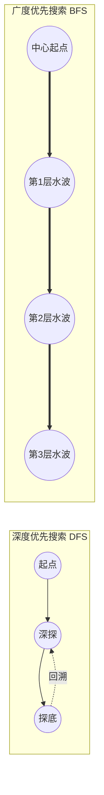

# 🧭 图算法基础与深度学习进阶指南

> **写在前面**：  
> 很多人以为“图论”离深度学习很远，其实恰恰相反——**现代 AI 的底层处处皆是图**：  
> - **PyTorch 自动求导（Autograd）**：底层是一个严格的有向无环图（DAG）；  
> - **CS224N 依存句法分析**：将一句话解析为一颗树（有向树也是一种特殊的图）；  
> - **大模型文本生成解码与搜索**：本质是庞大的语义状态图上的启发式路径搜索。  
>  
> 本指南精选了 **7 道最经典、ROI 最高的基础图论题目**，剔除复杂的竞赛冷门算法，专注于帮你在最短时间内建立起 **DFS（深度优先）与 BFS（广度优先）** 的肌肉记忆。

---

## 目录
- [一、 图算法的两大通用底座（心法与模板）](#一-图算法的两大通用底座心法与模板)
  - [1. 深度优先搜索 (DFS)：一条路走到黑 + 回溯打卡](#1-深度优先搜索-dfs一条路走到黑--回溯打卡)
  - [2. 广度优先搜索 (BFS)：波纹式扩散 + 队列最短路](#2-广度优先搜索-bfs波纹式扩散--队列最短路)
- [二、 阶梯式精选题单（共 7 题）](#二-阶梯式精选题单共-7-题)
  - [第一阶段：网格图 DFS（建立“访问打卡”直觉）](#第一阶段网格图-dfs建立访问打卡直觉)
  - [第二阶段：状态空间 BFS（掌握“层层扩散与最短路径”）](#第二阶段状态空间-bfs掌握层层扩散与最短路径)
  - [第三阶段：有向图与拓扑排序（PyTorch 计算图核心）](#第三阶段有向图与拓扑排序pytorch-计算图核心)
  - [第四阶段：树形递归与 LCA（句法分析与 AST 核心）](#第四阶段树形递归与-lca句法分析与-ast-核心)
- [三、 ACM 模式 C++ 图算法标准代码库](#三-acm-模式-c-图算法标准代码库)
  - [1. 网格图四方向移动数组](#1-网格图四方向移动数组)
  - [2. 通用图的邻接表存储](#2-通用图的邻接表存储)
- [四、 通往 LeetCode 211（前缀树通配符搜索）的认知桥梁](#四-通往-leetcode-211前缀树通配符搜索的认知桥梁)

---

## 一、 图算法的两大通用底座（心法与模板）

图算法虽然题型千变万化，但在工业界和面试中，90% 都在考下面这两种遍历思维：



### 1. 深度优先搜索 (DFS)：一条路走到黑 + 回溯打卡
* **数据结构**：函数调用栈（递归）或显式栈 `std::stack`。
* **核心思维**：不撞南墙不回头。
* **致命陷阱**：图中有环！必须维护 `visited`（或在原数组原地修改）进行**打卡防死循环**。

### 2. 广度优先搜索 (BFS)：波纹式扩散 + 队列最短路
* **数据结构**：先进先出队列 `std::queue`。
* **核心思维**：像石子投入平静湖面激起的水波，一层一层往外推。
* **无可替代的优势**：在无权图（每次移动代价为 1）中，**BFS 第一次碰到终点时，所经过的层数一定是全局最短路径！**

---

## 二、 阶梯式精选题单（共 7 题）

### 第一阶段：网格图 DFS（建立“访问打卡”直觉）
> **学习目标**：用最直观的二维棋盘网格，掌握“递归边界”与“节点访问标记”。

| 题号 | 题目名称 | 难度 | 核心考察点 | 深度学习 / 现实映射 |
| :---: | :--- | :---: | :--- | :--- |
| **200** | **岛屿数量 (Number of Islands)** | 中等 | **沉岛思想 / 网格图连通块** | **必刷第一题**！理解图算法中如何把访问过的节点“沉入水底”防止死循环。 |
| **695** | **岛屿的最大面积** | 中等 | 带返回值的 DFS 递归累加 | 训练递归向上传递数值、汇总子连通块信息的能力。 |

---

### 第二阶段：状态空间 BFS（掌握“层层扩散与最短路径”）
> **学习目标**：把“状态”抽象成图的节点，用队列求到达目标的最少步数。

| 题号 | 题目名称 | 难度 | 核心考察点 | 深度学习 / 现实映射 |
| :---: | :--- | :---: | :--- | :--- |
| **994** | **腐烂的橘子** | 中等 | **多源 BFS / 分钟层序扩散** | 多个腐烂源头同时发力，深刻体会队列 `queue` 的分层计数。 |
| **752** | **打开转盘锁** | 中等 | 隐式状态图的最短路径 | 每个 4 位密码是一个节点，转动是边。大模型解码剪枝搜索的前置思想。 |

---

### 第三阶段：有向图与拓扑排序（PyTorch 计算图核心）
> **学习目标**：处理具备“先修依赖关系”的 DAG（有向无环图）。

| 题号 | 题目名称 | 难度 | 核心考察点 | 深度学习 / 现实映射 |
| :---: | :--- | :---: | :--- | :--- |
| **207** | **课程表 (Course Schedule)** | 中等 | **入度表 + 队列 (Kahn 算法)** | **PyTorch 自动求导计算图**依赖解析的绝对核心；检测算子流是否存在死循环。 |
| **210** | **课程表 II** | 中等 | 打印完整的拓扑执行序列 | 编译器代码生成、算子流水线依赖调度的基础。 |

---

### 第四阶段：树形递归与 LCA（句法分析与 AST 核心）
> **学习目标**：树作为无环无向图的特殊形态，掌握后序遍历与祖先溯源。

| 题号 | 题目名称 | 难度 | 核心考察点 | 深度学习 / 现实映射 |
| :---: | :--- | :---: | :--- | :--- |
| **236** | **二叉树的最近公共祖先 (LCA)** | 中等 | 后序遍历递归向上归约 | **CS224N 依存句法树**解析的核心操作，判断两个词语在哪一层级语义汇合。 |

---

## 三、 ACM 模式 C++ 图算法标准代码库

在 ACM 模式中，图的构建与遍历有着高度标准化的工业级套路：

### 1. 网格图四方向移动数组
避免写 4 个冗长的 `if (up) ... if (down) ...`，用方向向量极简循环：

```cpp
// 上、下、左、右 四个方向的坐标偏移量
const int dx[4] = {-1, 1, 0, 0};
const int dy[4] = {0, 0, -1, 1};

// 遍历当前坐标 (x, y) 的四个邻居
for (int i = 0; i < 4; ++i) {
    int nx = x + dx[i];
    int ny = y + dy[i];

    // 严格检查是否越界
    if (nx >= 0 && nx < m && ny >= 0 && ny < n) {
        // 进入下一层逻辑...
    }
}
```

### 2. 通用图的邻接表存储
在 ACM 模式中，最轻量、高效的图存储方式是用 `vector<vector<int>>`：

```cpp
int n; // 节点总数 (0 ~ n-1)
vector<vector<int>> adj(n); // 邻接表：adj[u] 存所有能从 u 到达的邻居节点 v

// 加一条有向边 u -> v
adj[u].push_back(v);

// 加一条无向边 (等价于两条有向边)
adj[u].push_back(v);
adj[v].push_back(u);
```

---

## 四、 通往 LeetCode 211（前缀树通配符搜索）的认知桥梁

刷完上述基础后，你再回来看 **LeetCode 211（添加与搜索单词）**，会产生豁然开朗的顿悟：

* **网格图遍历（第 200 题）**：  
  在棋盘格子上，每个格子有 **4 个邻居方向**（上下左右），用循环遍历；
* **前缀树通配符搜索（第 211 题）**：  
  在前缀树上，每个节点有 **26 个树枝分支**（'a' ~ 'z'），遇到点号 `.` 时，就是对这 26 个孩子跑一次 DFS 递归！

本质完全相通！建议立刻从 **[200. 岛屿数量]** 开始建立手感！
